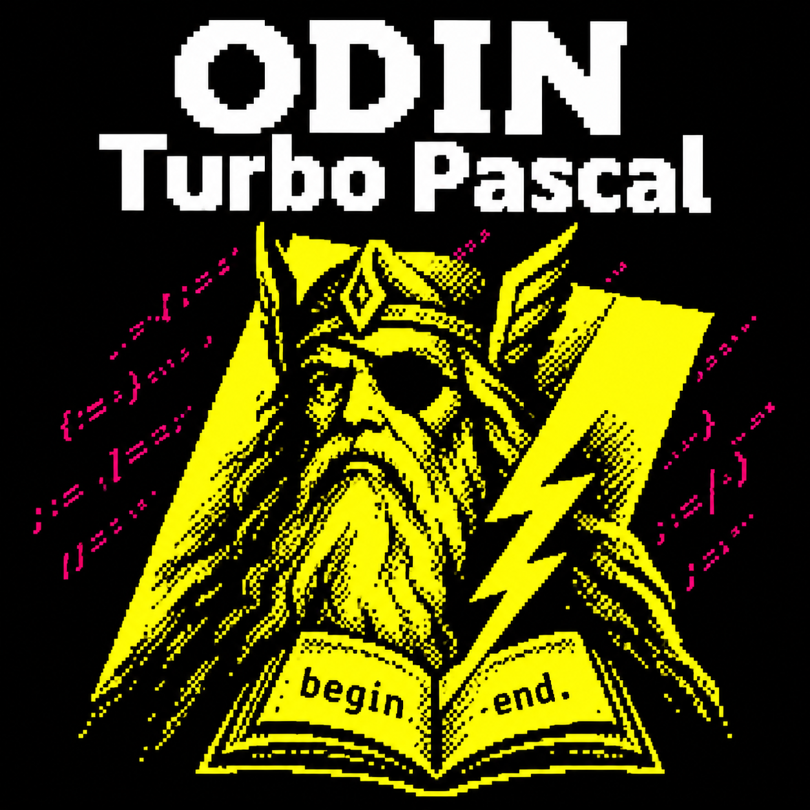
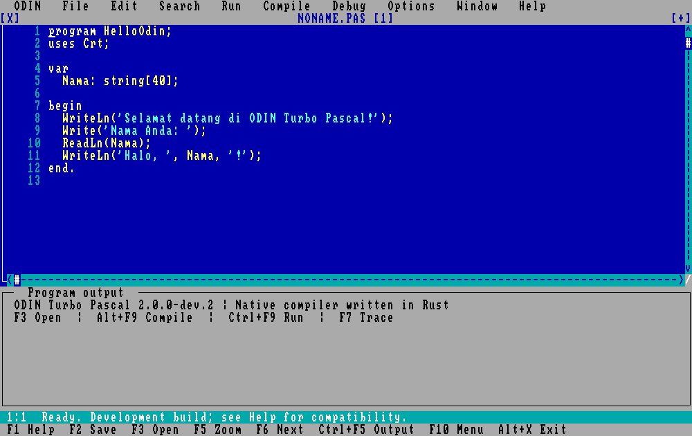
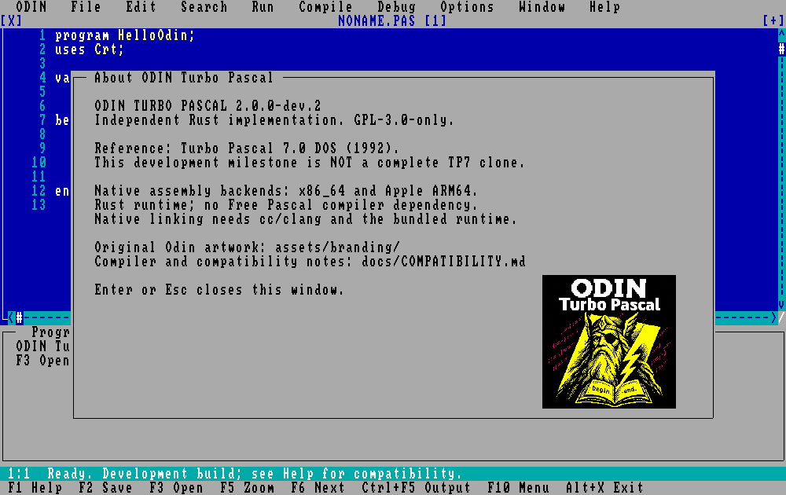
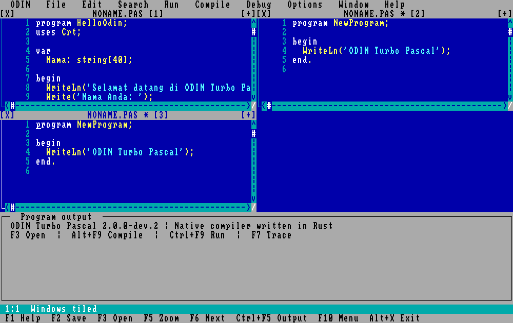
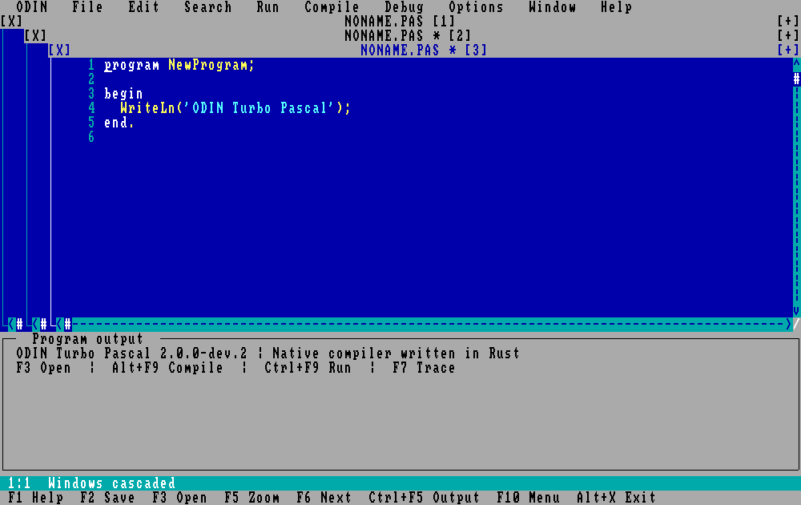
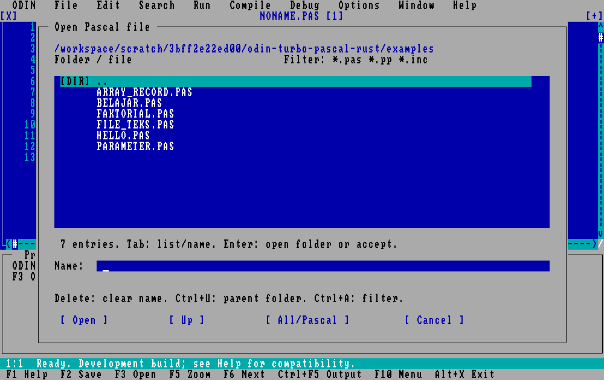
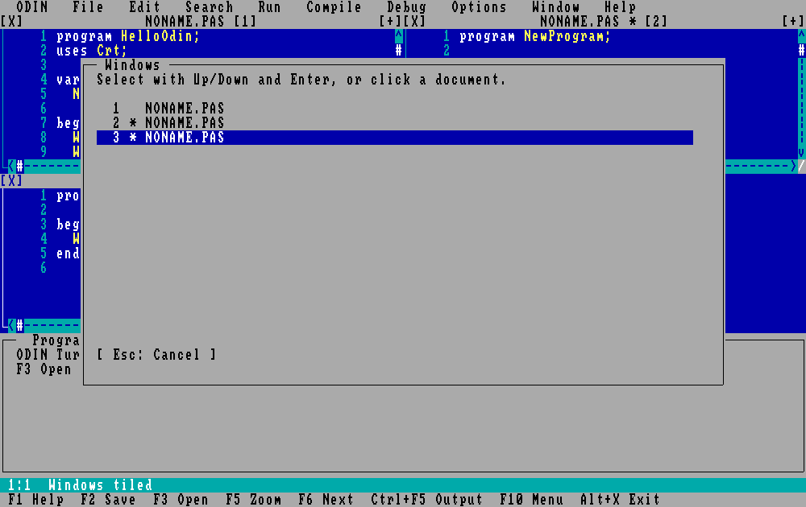

<div align="center">



# ODIN Turbo Pascal v2.0

**Compiler Pascal native yang ditulis ulang dalam Rust — menghidupkan nuansa Borland Turbo Pascal 7.0 untuk era modern, tanpa emulator, tanpa interpreter, tanpa Free Pascal.**

[](VERSION)
[](https://www.npmjs.com/package/odin-turbo-pascal)
[](LICENSE)
[](rust-toolchain.toml)
[](#-mulai-cepat)
[](tests/native_suite.py)
[](crates)
[](crates/otp-ide)
[](docs/COMPATIBILITY.md)
[](docs/COMPATIBILITY.md)
[](vendor/)

[**Mulai Cepat**](#-mulai-cepat) • [**Fitur**](#-fitur-unggulan) • [**IDE**](#-ide-desktop) • [**Compiler CLI**](#-compiler-cli) • [**Contoh**](#-contoh-program) • [**Dokumentasi**](#-dokumentasi) • [**Lisensi**](#-lisensi)

</div>

---

## 🧭 Tentang Proyek

**ODIN Turbo Pascal (OTP)** adalah reimplementasi Pascal native yang terinspirasi penuh oleh **Borland Turbo Pascal 7.0 DOS (1992)**, ditulis dari nol dalam **Rust 2021**, dengan identitas visual sendiri (ODIN) dan lisensi GPL-3.0-only. Dirancang untuk programmer modern yang merindukan kecepatan, kesederhanaan, dan kehangatan IDE DOS klasik — tanpa perlu DOSBox, tanpa file DCU warisan.

Kami **tidak** memakai Free Pascal, **tidak** mentranspilasikan Pascal ke Rust, dan **tidak** mengeksekusi bytecode atau AST interpreter. Compiler kami **memancarkan assembly native sejati** (x86_64 SysV / Win64 / Darwin, plus ARM64 Darwin) lalu menautkannya dengan runtime Rust `staticlib` menggunakan toolchain C host sebagai assembler/linker.

> ⚠️ **Milestone saat ini `2.0.0-dev.4`** — subset Pascal yang berfungsi, bisa dibangun end-to-end, lulus 48/48 native test, dan menghasilkan executable mandiri. Ini **belum** clone TP7 100% dan **belum** rilis produksi. Daftar jujur fitur yang didukung vs. yang masih kesenjangan ada di [**matriks kompatibilitas**](docs/COMPATIBILITY.md).

### Lihat dalam Aksi

```pascal
{ examples/HELLO.PAS }
program Hello;
begin
  WriteLn('Selamat datang di ODIN Turbo Pascal v2.0');
  WriteLn('Compiler dan runtime ditulis dalam Rust.');
end.
```

```console
$ npm install -g odin-turbo-pascal
$ otpc run examples/HELLO.PAS
Built native macos-x64: /path/to/HELLO
Selamat datang di ODIN Turbo Pascal v2.0
Compiler dan runtime ditulis dalam Rust.
```

Executable `HELLO` berdiri sendiri. Runtime Rust menautkan statis. Tidak butuh `otpc` lagi saat dijalankan.

---

## ✨ Fitur Unggulan

### 🎯 Compiler Native Sejati

- **Zero interpreter, zero bytecode.** Setiap `procedure`/`function` Pascal menjadi simbol native tersendiri (`otp_user_N`).
- **Empat backend assembly:** Linux x86_64 (SysV), Windows x64, macOS x86_64 (Darwin), macOS ARM64 (Apple Silicon).
- **Linker host apa saja:** `cc` atau `clang` default, dapat diganti lewat `OTP_CC`.
- **Executable mandiri:** `libotp_rtl.a` tertaut statis — hasil binary bisa dibagikan tanpa harus menyertakan `otpc` atau IDE.
- **Deterministik:** nilai lokal/global diinisialisasi nol, komparasi array/record struktural, output reproducible.

### 🧮 Subset Pascal yang Berfungsi Hari Ini

| Kategori | Didukung |
|---|---|
| **Integer** | `Byte`, `ShortInt`, `Integer` (16-bit), `Word`, `LongInt` (32-bit), opsi pengecekan overflow |
| **Real** | `Real48` enam byte, matematika via f64 intermediate |
| **String** | Short string hingga 255 byte, concat, Copy, Pos, Length |
| **Aggregate** | Array multidimensi (**range-check selalu aktif**), record, parameter `value`/`var` |
| **Routine** | `procedure`/`function` bersarang dengan lexical scope, rekursi, `Exit`, `Break`, `Continue` |
| **Kontrol** | `if/else`, `while`, `repeat`, `for to/downto`, `case` rentang |
| **I/O teks** | `Write/WriteLn` dengan width + decimals, `Read/ReadLn`, `Assign/Reset/Rewrite/Close/Erase/Flush/Eof` |
| **Builtin math** | `Abs`, `Sqr`, `Sqrt`, `Sin`, `Cos`, `ArcTan`, `Ln`, `Exp`, `Round`, `Trunc`, `Pi`, `Odd`, `Inc`, `Dec`, `Succ`, `Pred`, `Lo`, `Hi` |
| **CRT (via ANSI)** | `ClrScr`, `ClrEol`, `GotoXY`, `WhereX/Y`, `TextColor`, `TextBackground` |
| **Sistem** | `ParamCount`, `ParamStr`, `Halt`, `Delay`, `Random`, `Randomize`, `IOResult` |
| **Direktif** | `{$R+/-}`, `{$Q+/-}`, `{$D+/-}` seluruh program (ditolak kalau lokal) |

Rencana lengkap sampai TP7 compatibility (pointer, Object Pascal, BGI, Turbo Vision) ada di [docs/RENCANA.md](docs/RENCANA.md).

### 🖥️ IDE Desktop ber-Nuansa TP7

- Jendela per dokumen, **Tile**, **Cascade**, **Zoom/Restore**, daftar jendela interaktif
- Keybinding klasik: **F2** save · **F3** open · **F10** menu · **Alt+X** keluar · **Alt+F9** compile · **Ctrl+F9** run · **Ctrl+F2** stop
- Debugger terintegrasi: **F7** trace · **F8** step over · **Ctrl+F8** toggle breakpoint
- Scrollbar vertikal/horizontal, drag + resize, roda mouse (Shift+roda = horizontal)
- File browser dengan konfirmasi overwrite, filter Ctrl+A, Ctrl+U naik folder
- Find/Replace (`cari|pengganti`), undo/redo, selection, clipboard internal OTP (Ctrl+C/X/V, Ctrl+Z/Y)
- **Auto-recovery:** jendela yang ditutup paksa window manager menyimpan draft ke subfolder `odin-turbo-pascal-recovery`
- Rendering lewat framebuffer bitmap native via [`minifb`](https://github.com/emoon/rust_minifb) + [`font8x8`](https://github.com/dhepper/font8x8) — **tanpa Electron, tanpa Qt, tanpa X11 shim bercabang**

### 🐛 Debugger Loopback

- Statement stepping, step-over, continue, breakpoint baris, snapshot nilai scalar
- Komunikasi `otp`/`otpc` ↔ child process via **TCP loopback ephemeral** — tanpa jaringan non-lokal
- Hook `otp_line` disisipkan compiler sebelum setiap statement
- CLI interaktif: `otpc debug HELLO.PAS` menerima `s` / `n` / `c` / `b NOMOR` / `q`

### 🔒 Aman Secara Default

- **Range check array & string selalu diemit** — `{$R-}` bukan izin untuk akses memori liar
- **Tanpa shell.** Semua eksekusi eksternal pakai `std::process::Command` dengan argv array — tidak ada injeksi
- **Tanpa telemetry.** Tidak ada koneksi non-loopback, tidak ada analytics, tidak ada phone-home
- **Build offline.** Semua dependensi di-vendor di `vendor/`; cargo dikonfigurasi offline sejak awal
- **Supply chain diaudit:** SHA256 untuk setiap source dan artefak rilis tercatat di [`BUILD-MANIFEST.json`](BUILD-MANIFEST.json)

### 📦 Pemaketan Multi-Platform

| Target | Format | Status build + uji |
|---|---|---|
| 🐧 **Linux x86_64** | `.tar.gz` + `install-linux.sh` per-user · npm `@odin-turbo-pascal/linux-x64` | ✅ CI `ubuntu-24.04`: build, native suite 48/48, npm install |
| 🍎 **macOS Intel (x86_64)** | `.tar.gz` + `.app` (ad-hoc codesigned) + `.dmg` + `install-macos.sh` · npm `@odin-turbo-pascal/darwin-x64` | ✅ CI `macos-15-intel` + lokal macOS 15.7.9: build, native suite 48/48, npm install |
| 🍏 **macOS Apple Silicon** | `.tar.gz` + `.app` + `.dmg` + `install-macos.sh` · npm `@odin-turbo-pascal/darwin-arm64` | ✅ CI `macos-14` (ARM64): build, native suite 48/48, npm install |
| 🪟 **Windows x64** | `.zip` + `install-windows.ps1` per-user · npm `@odin-turbo-pascal/win32-x64` | ✅ CI `windows-2022`: build, native suite 48/48, npm install |

`scripts/package.py` mengemas host aktif saja — tidak cross-compile. CI di [`.github/workflows/native.yml`](.github/workflows/native.yml) membangun dan menguji keempat host pada setiap push; [`release.yml`](.github/workflows/release.yml) menerbitkan GitHub Release dan paket npm saat tag `v*` di-push.

---

## 🚀 Mulai Cepat

### 📦 Instal lewat npm (direkomendasikan, semua OS)

[](https://www.npmjs.com/package/odin-turbo-pascal)

Cukup satu baris:

```sh
npm install -g odin-turbo-pascal
```

Perintah ini memasang dua program: **`otpc`** (compiler CLI) dan **`otp`** (IDE desktop). npm otomatis mengunduh paket biner yang cocok untuk OS dan CPU Anda. Tidak ada skrip `postinstall`, dan tidak ada unduhan tambahan di luar registry npm.

| Sistem | Paket biner yang dipasang otomatis |
|---|---|
| macOS Apple Silicon | [`@odin-turbo-pascal/darwin-arm64`](https://www.npmjs.com/package/@odin-turbo-pascal/darwin-arm64) |
| macOS Intel | [`@odin-turbo-pascal/darwin-x64`](https://www.npmjs.com/package/@odin-turbo-pascal/darwin-x64) |
| Linux x64 (glibc) | [`@odin-turbo-pascal/linux-x64`](https://www.npmjs.com/package/@odin-turbo-pascal/linux-x64) |
| Windows x64 | [`@odin-turbo-pascal/win32-x64`](https://www.npmjs.com/package/@odin-turbo-pascal/win32-x64) |

**Prasyarat**

- **Node.js 16+** (sudah termasuk npm).
- **Linker C sistem**, karena `otpc` menautkan program Pascal menjadi executable native:
  - **macOS**: Xcode Command Line Tools: `xcode-select --install`
  - **Linux**: `build-essential` (menyediakan `cc`); IDE desktop butuh X11/XWayland
  - **Windows**: Visual Studio C++ Build Tools + LLVM `clang` di PATH; jalankan dari *x64 Native Tools Command Prompt*

**Periksa hasil instalasi**

```sh
otpc --version     # ODIN Turbo Pascal 2.0.0-dev.4
otpc doctor        # runtime dan linker siap?
```

**Program pertama**: simpan sebagai `HELLO.PAS`, lalu jalankan:

```pascal
program Hello;
begin
  WriteLn('Halo dari ODIN Turbo Pascal!');
end.
```

```sh
otpc run HELLO.PAS     # kompilasi ke executable native, lalu jalankan
otp HELLO.PAS          # atau buka di IDE desktop
```

**Coba tanpa instal global**

```sh
npx -p odin-turbo-pascal otpc doctor
npx -p odin-turbo-pascal otpc run HELLO.PAS
```

**Perbarui dan hapus**

```sh
npm update -g odin-turbo-pascal       # ke versi terbaru
npm uninstall -g odin-turbo-pascal    # hapus otpc, otp, dan paket biner platform
```

**Kalau ada masalah**

- *`platform package @odin-turbo-pascal/... is not installed`*: npm dijalankan dengan `--omit=optional` atau `--no-optional`. Pasang ulang tanpa opsi itu.
- *`no prebuilt binaries for ...`*: OS/CPU Anda belum didukung (misalnya Linux ARM). Bangun dari source, lihat [Membangun dari Source](#️-membangun-dari-source).
- *`Linker 'cc' unavailable`* atau *`Native linking failed`*: linker C belum terpasang. Lihat prasyarat di atas, lalu jalankan `otpc doctor` lagi.
- Paket Linux dibangun di Ubuntu 24.04; distro dengan glibc lebih lama belum diverifikasi.

Rincian paket npm ada di [`npm/odin-turbo-pascal`](npm/odin-turbo-pascal/README.md).

Arsip per platform juga tersedia di [GitHub Releases](https://github.com/Syamsuddin/otp/releases) (macOS: `.dmg` dan `.tar.gz`; Linux: `.tar.gz`; Windows: `.zip`), masing-masing dengan berkas `.sha256`.

### 🐧 Linux x86_64

```sh
curl -LO https://github.com/Syamsuddin/otp/releases/download/v2.0.0-dev.4/OTP-2.0.0-dev.4-linux-x64.tar.gz
tar -xzf OTP-2.0.0-dev.4-linux-x64.tar.gz
cd OTP-2.0.0-dev.4-linux-x64
sh install-linux.sh                       # pasang di ~/.local/bin (atau OTP_PREFIX)
~/.local/bin/otpc doctor                  # periksa host + linker
~/.local/bin/otp                          # buka IDE desktop
```

Prasyarat: X11/XWayland, `cc` + `build-essential`, Python 3.

### 🍎 macOS (Intel / Apple Silicon)

```sh
# Ganti macos-x64 dengan macos-arm64 untuk Apple Silicon.
# Opsi 1 — DMG
curl -LO https://github.com/Syamsuddin/otp/releases/download/v2.0.0-dev.4/OTP-2.0.0-dev.4-macos-x64.dmg
open OTP-2.0.0-dev.4-macos-x64.dmg
# drag "ODIN Turbo Pascal.app" ke /Applications

# Opsi 2 — tarball + installer per-user
curl -LO https://github.com/Syamsuddin/otp/releases/download/v2.0.0-dev.4/OTP-2.0.0-dev.4-macos-x64.tar.gz
tar -xzf OTP-2.0.0-dev.4-macos-x64.tar.gz
cd OTP-2.0.0-dev.4-macos-x64
sh install-macos.sh                       # pasang CLI di ~/.local/bin + .app di ~/Applications
~/.local/bin/otpc doctor
~/.local/bin/otpc run examples/HELLO.PAS
open ~/Applications/"ODIN Turbo Pascal.app"
```

Prasyarat: Xcode Command Line Tools, Python 3. macOS 11+ (direncanakan).

### 🪟 Windows x64

```powershell
Invoke-WebRequest https://github.com/Syamsuddin/otp/releases/download/v2.0.0-dev.4/OTP-2.0.0-dev.4-windows-x64.zip -OutFile OTP-2.0.0-dev.4-windows-x64.zip
Expand-Archive OTP-2.0.0-dev.4-windows-x64.zip -DestinationPath .
cd OTP-2.0.0-dev.4-windows-x64
.\install-windows.ps1
otpc doctor
otp
```

Prasyarat: Visual Studio C++ Build Tools / Windows SDK, LLVM clang di PATH, Python 3. Jalankan dari **x64 Native Tools Developer Shell**.

---

## 🔧 Compiler CLI

```sh
otpc check HELLO.PAS                              # periksa semantik saja
otpc build HELLO.PAS -o hello                     # bangun executable native
otpc run   HELLO.PAS -- arg1 arg2                 # bangun + jalankan
otpc build HELLO.PAS --range-check --overflow-check
otpc debug HELLO.PAS                              # debugger CLI interaktif
otpc emit-asm HELLO.PAS --target macos-arm64 -o hello.s
otpc doctor                                       # host + runtime + linker check
```

**Environment variables:**

| Variabel | Fungsi |
|---|---|
| `OTP_CC` | Nama / path linker C (default `cc` atau `clang`) |
| `OTP_RUNTIME` | Path arsip runtime (`libotp_rtl.a` atau `otp_rtl.lib`) |
| `OTP_PREFIX` | Target direktori installer |
| `MACOSX_DEPLOYMENT_TARGET` | Deployment target macOS (direncanakan `11.0`) |

---

## 🖼️ IDE Desktop

Jalankan `otp` atau `otp FILE.PAS`.

<table>
  <tr>
    <td align="center" width="50%">
      <br>
      <sub><b>Editor klasik dengan menu bar</b></sub>
    </td>
    <td align="center" width="50%">
      <br>
      <sub><b>Dialog About ber-logo ODIN</b></sub>
    </td>
  </tr>
  <tr>
    <td align="center">
      <br>
      <sub><b>Window Tile</b></sub>
    </td>
    <td align="center">
      <br>
      <sub><b>Window Cascade</b></sub>
    </td>
  </tr>
  <tr>
    <td align="center">
      <br>
      <sub><b>File browser modal</b></sub>
    </td>
    <td align="center">
      <br>
      <sub><b>Daftar jendela aktif</b></sub>
    </td>
  </tr>
</table>

### Ringkasan Keybinding

| Kategori | Shortcut |
|---|---|
| **File** | **F2** Save · **F3** Open · **Alt+X** Keluar · **Ctrl+F** Find · **Ctrl+L** Find next |
| **Window** | **F6** / **Shift+F6** pindah dokumen · **F5** Zoom · **Alt+F3** Close · **F10** Menu |
| **Edit** | **Ctrl+C/X/V** clipboard internal · **Ctrl+Z/Y** undo/redo · **Shift+panah** select |
| **Run** | **Alt+F9** compile · **Ctrl+F9** run · **Ctrl+F2** stop · **Ctrl+F5** zoom output |
| **Debug** | **F7** trace · **F8** step over · **Ctrl+F8** toggle breakpoint |

### Headless Screenshot (CI-friendly)

```sh
otp --screenshot out.ppm --about     # juga: --tile, --cascade, --files, --windows
```

Dokumentasi perbaikan jendela lengkap: [docs/WINDOWS-dev2.md](docs/WINDOWS-dev2.md).

---

## 📝 Contoh Program

Enam contoh belajar lengkap ada di [`examples/`](examples/):

| File | Pelajaran |
|---|---|
| [HELLO.PAS](examples/HELLO.PAS) | Dasar `WriteLn` |
| [BELAJAR.PAS](examples/BELAJAR.PAS) | Input `ReadLn`, aritmetika real, format `:0:2` |
| [FAKTORIAL.PAS](examples/FAKTORIAL.PAS) | Rekursi dan loop |
| [PARAMETER.PAS](examples/PARAMETER.PAS) | Parameter `value` vs `var` |
| [ARRAY_RECORD.PAS](examples/ARRAY_RECORD.PAS) | Array of record, iterasi |
| [FILE_TEKS.PAS](examples/FILE_TEKS.PAS) | Text file I/O |

```pascal
{ examples/ARRAY_RECORD.PAS }
program DataSiswa;
type TSiswa = record
  nama: string[30];
  nilai: Integer;
end;
var siswa: array[1..3] of TSiswa; i, total: Integer;
begin
  siswa[1].nama := 'Ayu';   siswa[1].nilai := 90;
  siswa[2].nama := 'Budi';  siswa[2].nilai := 80;
  siswa[3].nama := 'Citra'; siswa[3].nilai := 85;
  total := 0;
  for i := 1 to 3 do begin
    WriteLn(siswa[i].nama:10, siswa[i].nilai:5);
    total := total + siswa[i].nilai;
  end;
  WriteLn('Rata-rata: ', total / 3:0:2);
end.
```

---

## 🏗️ Membangun dari Source

**Prasyarat:** Rust **1.85.1** (dipin di [`rust-toolchain.toml`](rust-toolchain.toml)) + host C compiler + Python 3. Semua crate dependensi sudah di-vendor di `vendor/`; cargo offline-by-default.

```sh
cargo build --workspace --release --locked --offline     # compile semua crate
cargo test  --workspace --locked --offline               # 12 Rust tests + 11 editor tests
python3 tests/native_suite.py --release                  # 48 native black-box tests
python3 scripts/package.py --skip-build                  # bundle hasil host saat ini
```

Pada Windows ganti `python3` dengan `python`. Tanpa `--skip-build`, `scripts/package.py` menjalankan build + test + native suite dari awal.

### Target Build

| Host | Prasyarat tambahan |
|---|---|
| Linux x86_64 | `build-essential`, X11/XWayland untuk desktop |
| Windows x86_64 | VS C++ Build Tools, Windows SDK, LLVM clang di PATH, **x64 Native Tools shell** |
| macOS Intel | Xcode Command Line Tools |
| macOS Apple Silicon | Xcode Command Line Tools (host ARM64) |

---

## 📂 Struktur Proyek

```
otp/
├── crates/
│   ├── otp-core/      # lexer, parser, semantic, codegen, linker driver
│   ├── otp-types/     # deskripsi tipe + storage Real48
│   ├── otp-rtl/       # runtime Rust (staticlib + rlib)
│   ├── otp-cli/       # binary `otpc`
│   └── otp-ide/       # binary desktop `otp` (minifb + font8x8)
├── examples/          # 6 program Pascal belajar
├── tests/
│   └── native_suite.py # 48 black-box test terhadap executable
├── packaging/         # install-linux.sh, install-windows.ps1
├── scripts/
│   ├── package.py     # bundle host saat ini
│   └── bundle_source.py
├── docs/              # ARCHITECTURE, COMPATIBILITY, RENCANA, IMPLEMENTASI, …
├── assets/branding/   # logo master ODIN
├── vendor/            # dependensi Rust ter-vendored (offline build)
├── third-party-licenses/
├── dist/              # artefak rilis (.tar.gz, .dmg, .sha256)
└── .github/workflows/ # CI multi-host
```

---

## 📚 Dokumentasi

| Dokumen | Isi |
|---|---|
| [COMPATIBILITY.md](docs/COMPATIBILITY.md) | **Matriks jujur** fitur yang didukung vs. kesenjangan terhadap TP7 |
| [ARCHITECTURE.md](docs/ARCHITECTURE.md) | Arsitektur compiler + runtime + IDE |
| [RENCANA.md](docs/RENCANA.md) | Target akhir TP7-complete (bukan status, tapi roadmap) |
| [IMPLEMENTASI.md](docs/IMPLEMENTASI.md) | Catatan pengerjaan + bukti milestone |
| [WINDOWS-dev2.md](docs/WINDOWS-dev2.md) | Panduan sistem jendela IDE |

---

## 🤝 Berkontribusi

Perubahan compiler atau runtime harus:
1. **Update [docs/COMPATIBILITY.md](docs/COMPATIBILITY.md)** di commit yang sama (dokumen itu adalah source of truth untuk subset).
2. **Tambah test** ke `tests/native_suite.py` — baris di `CASES` (sukses), `BAD` (error compile), atau `ERRORS` (error runtime).
3. **Jangan "hijaukan" test dengan melonggarkan check** — perbaiki compiler.
4. Builtin yang belum diimplementasi ditolak sebagai `unknown`/`unimplemented` — **jangan silent-shim dengan no-op**.
5. Range check & overflow check tetap aktif meski `{$R-}`/`{$Q-}` disertakan di source — directive mengubah pelaporan, bukan menghapus guard.

---

## 📜 Lisensi

Source compiler, runtime, IDE, dan skrip pemasangan OTP: **GPL-3.0-only**, lihat [`LICENSE`](LICENSE). Belum ada pengecualian linking runtime pada milestone ini — binary hasil kompilasi juga mewarisi GPL-3.0-only kecuali ditetapkan lain di rilis mendatang.

Library pihak ketiga mempertahankan lisensinya masing-masing. Daftar lengkap di [`THIRD_PARTY.md`](THIRD_PARTY.md) dan folder [`third-party-licenses/`](third-party-licenses/).

---

## 🎖️ Pengakuan

- **Nama "Turbo Pascal"** adalah milik Borland (sekarang Embarcadero). Proyek ini **tidak** memuat source, executable, font, help database, atau manual Borland. Semua kode ditulis dari nol dengan acuan buku, dokumentasi, dan contoh program publik.
- **Nama "ODIN"** dan logo di [`assets/branding/`](assets/branding/) adalah identitas proyek ini.
- Font bitmap: [**font8x8**](https://github.com/dhepper/font8x8) oleh Daniel Hepper (public domain).
- Windowing & framebuffer: [**minifb**](https://github.com/emoon/rust_minifb) oleh Daniel Collin.
- PNG decoder: [**image-rs/png**](https://github.com/image-rs/image-png).

---

<div align="center">

**ODIN Turbo Pascal v2.0** — ditulis dengan ❤️ dalam Rust  <br>
Dibangun untuk pelajar, nostalgia-coder, dan siapa pun yang percaya Pascal masih mengajarkan hal yang indah.

[⬆ kembali ke atas](#odin-turbo-pascal-v20)

</div>
